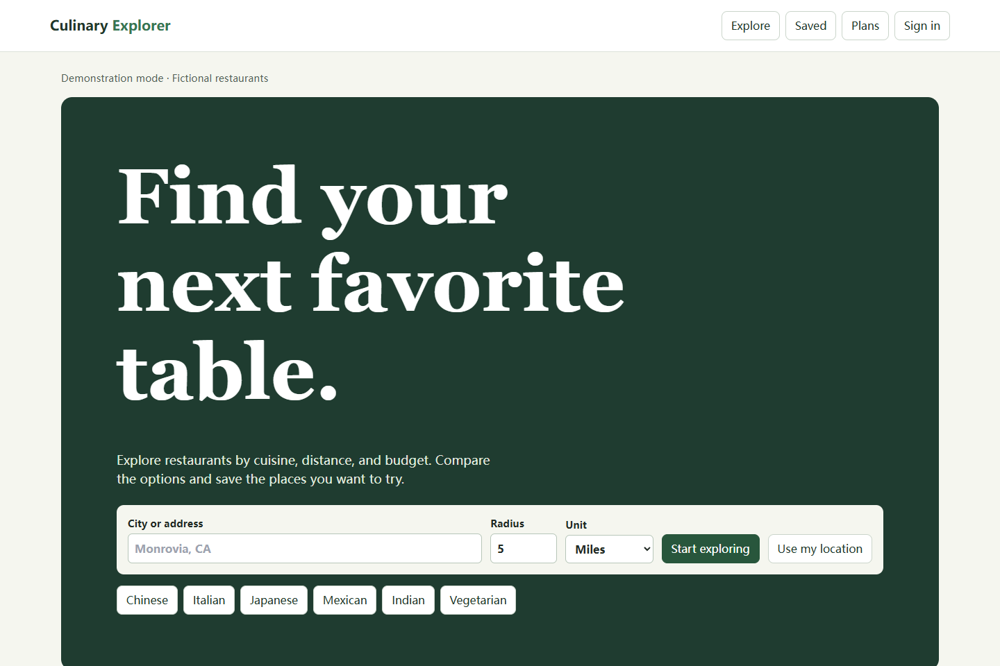
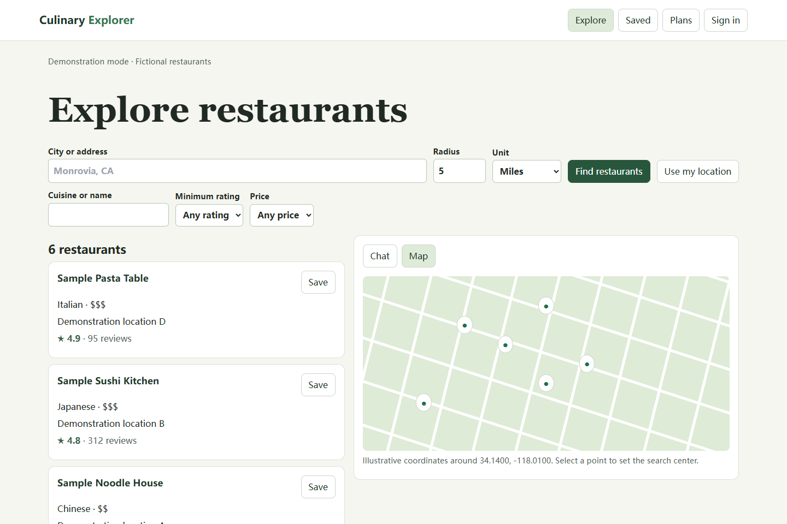
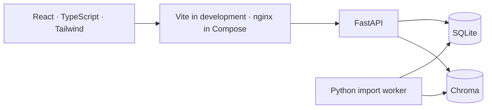

# Culinary Explorer

[GitHub repository](https://github.com/hwen020/culinary-explorer) | [GitHub Actions](https://github.com/hwen020/culinary-explorer/actions)

Culinary Explorer is a local-first restaurant discovery demo. Search an illustrative neighborhood, filter restaurants, open map markers, save favorites, and ask about your results. The demo uses fictional restaurant records and works without API keys, billing accounts, or an AI model.



## What you can do

- Search by location, radius, cuisine, price, and rating.
- Explore fictional results on an illustrative map and export the filtered demo rows to CSV.
- Register a local account, save restaurants, and restore conversations after signing in again.
- Ask for suggestions grounded in the current results. Offline answers are labeled as deterministic demo results.
- In a separately configured live environment, ingest authorized CSV data with a background worker and maintain a persistent Chroma index.



## Architecture



Vite builds the frontend. FastAPI exposes the API, manages sessions, and applies SQLAlchemy migrations. The worker processes authorized imports. LangChain supports configured model-backed retrieval, and an optional PostgreSQL connection is documented. The default local database is SQLite.

## Run the demo

**Windows 10 or 11.** Install Python 3.12 and Node.js 20 or newer. Run `start_windows.bat`, open [http://localhost:5173](http://localhost:5173), and use `stop_windows.bat` when finished. First launch installs pinned dependencies. The launcher keeps any existing `.env` and starts in offline Demo mode. See [Windows and VS Code setup](docs/SETUP_WINDOWS.md).

**Manual setup on Linux or macOS.** With Python 3.12 and Node.js 20 or newer, install the locked dependencies from the project root.

```sh
python3.12 -m venv .venv
source .venv/bin/activate
python -m pip install -r requirements-lock.txt
npm ci
```

Start each command in a separate terminal from the same directory. Activate the virtual environment in the two Python terminals.

```sh
CULINARY_MODE=demo CULINARY_DEPLOYMENT=development OLLAMA_MODEL= python -m uvicorn backend.main:app --port 8000
CULINARY_MODE=demo CULINARY_DEPLOYMENT=development python -m backend.worker
npm run dev
```

Open [http://localhost:5173](http://localhost:5173). The worker performs maintenance and is required for background imports. The [Docker guide](docs/DOCKER_DEPLOYMENT.md) describes the Compose stack. Compose configuration has passed validation. Container runtime remains unverified.

## Public preview

The [deployment report](docs/PUBLIC_DEPLOYMENT_REPORT.md) records live verification status. The [Render Free guide](docs/PUBLIC_DEMO.md) uses a single FastAPI service for the React build and API. The local same-origin preview has passed two additional browser tests. Visitors use temporary guest sessions with fictional data, and saved activity can reset on restart or sleep.

## Test results

The latest local run passed **11 Pytest tests**, **2 Vitest tests**, **2 Edge Playwright tests**, TypeScript checking, and the Vite production build. The [GitHub Actions workflow](.github/workflows/ci.yml) is configured to run the credential-free suite on Ubuntu with Chromium. The initial public commit passed the [hosted GitHub Actions run](https://github.com/hwen020/culinary-explorer/actions/runs/44796913903). See [testing commands](docs/TESTING.md) and [release checks](docs/GITHUB_RELEASE_CHECKLIST.md).

## Data policy and limits

- Demo restaurants and map coordinates are illustrative. Demo and live accounts use separate databases by default.
- Authorized imports may be stored, exported and indexed only when the operator has the rights to do so. Google Places discovery is optional, and Google content is excluded from CSV exports and vector indexing. [Data policy](docs/DATA_POLICY.md)
- Real Google Places, Maps, model, SMTP, Stripe test-account, and PostgreSQL integrations have not been verified in this workspace. Provider behavior covered by mocks does not establish live integration. Stripe billing remains disabled in production.
- This public source distribution contains the React frontend and FastAPI backend.

See the [environment reference](docs/ENVIRONMENT_VARIABLES.md) for external settings, the [implementation status](docs/IMPLEMENTATION_STATUS.md) for verification details, and the [license](LICENSE) and [third-party notices](docs/THIRD_PARTY_NOTICES.md) for redistribution scope.
